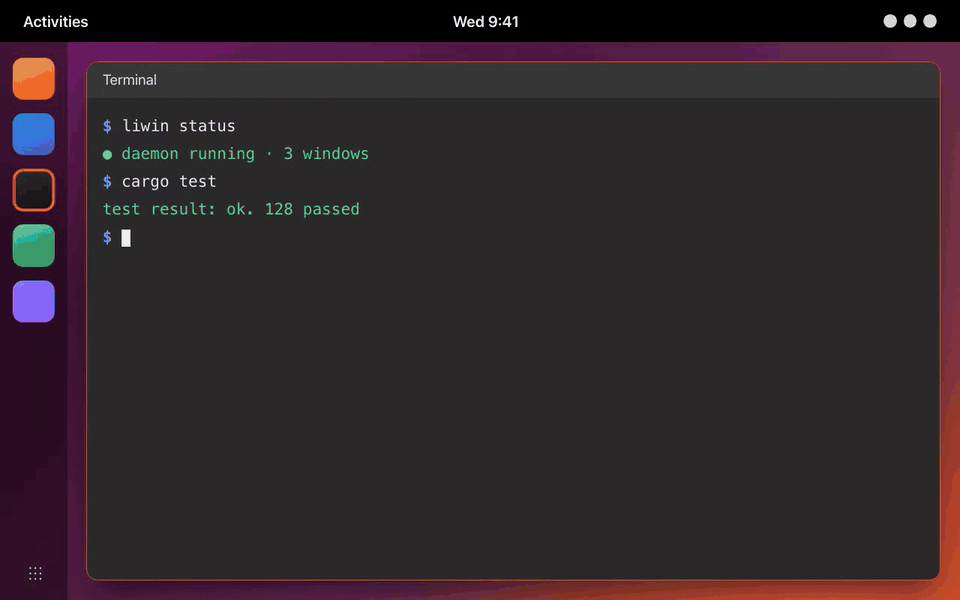

# liwin

**Tiling windows for GNOME, without leaving GNOME.** liwin brings the i3 /
AeroSpace way of working to the stock GNOME Shell on Wayland: windows tile
themselves as they open, and you focus, move and re-arrange them from the
keyboard. No new desktop, no new session.

**[Product page](https://hina-kura49.github.io/liwin/)** ·
**[Download](#download)** ·
[Releases](https://github.com/hina-kura49/liwin/releases/latest)

<p align="center">
  
</p>
<p align="center"><sub>Illustration of the workflow, not a screen recording.</sub></p>

## Download

Needs **GNOME Shell 50 on Wayland**, x86_64 or aarch64. Installs for your user
only (no root):

```sh
curl -fsSL https://github.com/hina-kura49/liwin/releases/latest/download/install.sh | bash
```

The script downloads the latest release, checks `SHA256SUMS`, puts `liwin`
and `liwin-daemon` in `~/.local/bin`, installs the GNOME Shell extension and
adds a systemd user unit that starts the daemon with your session. Then
**log out and back in** — GNOME on Wayland loads new extensions at login. If
the extension is not active afterwards, run `gnome-extensions enable liwin@kura`
(or switch it on in the *Extensions* app).

Prefer to do it by hand? Download the files from the
[latest release](https://github.com/hina-kura49/liwin/releases/latest):

| File | What it is |
|------|------------|
| [`liwin-linux-x86_64.tar.gz`](https://github.com/hina-kura49/liwin/releases/latest/download/liwin-linux-x86_64.tar.gz) | `liwin` + `liwin-daemon` for Intel / AMD |
| [`liwin-linux-aarch64.tar.gz`](https://github.com/hina-kura49/liwin/releases/latest/download/liwin-linux-aarch64.tar.gz) | `liwin` + `liwin-daemon` for ARM64 |
| [`liwin@kura.shell-extension.zip`](https://github.com/hina-kura49/liwin/releases/latest/download/liwin@kura.shell-extension.zip) | the GNOME Shell extension |
| [`SHA256SUMS`](https://github.com/hina-kura49/liwin/releases/latest/download/SHA256SUMS) | checksums |

```sh
tar -xzf liwin-linux-x86_64.tar.gz
install -m 755 liwin-*/liwin liwin-*/liwin-daemon ~/.local/bin/
gnome-extensions install --force liwin@kura.shell-extension.zip
# log out and back in, then:
gnome-extensions enable liwin@kura
liwin-daemon &    # or start it from a systemd user unit
```

To remove everything the script installed:
`curl -fsSL https://github.com/hina-kura49/liwin/releases/latest/download/install.sh | bash -s -- --uninstall`

## When you'll use it

- **You came from i3, sway or AeroSpace** but want to stay on stock Ubuntu or
  Fedora GNOME — its settings, notifications, screen sharing and updates. The
  default keys follow AeroSpace, so your muscle memory still works.
- **A coding layout without dragging.** Open your editor, a terminal and a
  browser; they split the screen on their own. `Alt+Shift+L` pushes the
  terminal right, `Alt+/` flips the split from side-by-side to stacked.
- **Several monitors, several workspaces.** Every GNOME workspace on every
  monitor is tiled on its own. `Alt+1`…`9` jumps between workspaces,
  `Alt+Shift+1`…`9` sends the focused window there.
- **Scripting your desk.** Everything goes through a D-Bus service, so
  `liwin focus left` or `liwin move-node-to-workspace 2` works from a shell
  script, a GNOME custom shortcut or `busctl`.

## Features

- **Automatic tiling.** Windows are tiled per GNOME workspace and monitor as
  they open and close — no manual arranging. Dialogs and fixed-size windows
  float.
- **Keyboard-driven.** Focus, move, layout and workspace commands, bound to
  keys in an AeroSpace-style config. Works with no config at all.
- **Plays nice with GNOME.** Runs on top of the stock GNOME Shell. Keys
  already used by GNOME are skipped, never stolen.
- **Scriptable.** A documented D-Bus API and the `liwin` command share one
  command language.
- **Private.** Nothing leaves your machine; window titles and app ids are not
  even sent to the daemon.

## Default keys

| Keys | Action |
|------|--------|
| `Alt+H` / `J` / `K` / `L` | Focus the window left / down / up / right |
| `Alt+Shift+H` / `J` / `K` / `L` | Move the focused window left / down / up / right |
| `Alt+/` | Toggle the split between horizontal and vertical |
| `Alt+1` … `9` | Switch to workspace 1 … 9 |
| `Alt+Shift+1` … `9` | Move the focused window to workspace 1 … 9 |

## Configuration

Optional. Create `~/.config/liwin/liwin.toml`, using AeroSpace key names. A
config file replaces the built-in keys completely:

```toml
config-version = 2

[mode.main.binding]
alt-h = 'focus left'
alt-j = 'focus down'
alt-k = 'focus up'
alt-l = 'focus right'
alt-shift-l = 'move right'
alt-slash = 'layout tiles horizontal vertical'
alt-1 = 'workspace 1'
alt-shift-1 = 'move-node-to-workspace 1'
```

Keys already used by GNOME are skipped (never stolen) and reported in the
daemon log (`journalctl --user -u liwin`).

The same commands work from the terminal while the daemon runs:

```sh
liwin focus left
liwin move-node-to-workspace 2
liwin list-windows
```

## Troubleshooting

- **Nothing happens after installing.** Log out and back in first. Then check
  `gnome-extensions info liwin@kura` (should say *ENABLED*) and
  `systemctl --user status liwin`.
- **A key does nothing.** GNOME probably uses it already; the daemon log says
  so. Pick another key in `liwin.toml`.
- **Other GNOME versions.** Only GNOME Shell 50 on Wayland is supported and
  tested for now. X11 sessions are not supported.

## For developers

Building from source, the nested test Shell, the architecture and the D-Bus
protocol are described in [docs/DEVELOPMENT.md](docs/DEVELOPMENT.md),
[docs/ARCHITECTURE.md](docs/ARCHITECTURE.md), [docs/dbus.md](docs/dbus.md)
and [CONTRIBUTING.md](CONTRIBUTING.md).

## Author

Made by kura —
[GitHub](https://github.com/hina-kura49) ·
[Portfolio](https://hina-kura49.github.io/portfolio/) ·
[X](https://x.com/hkurashina49) ·
[Instagram](https://www.instagram.com/hina_kura49/) ·
[Facebook](https://www.facebook.com/profile.php?id=61597175063829)

## License

liwin is made of parts under different licenses:

| Part | License | License files |
|------|---------|---------------|
| GNOME Shell extension (`extension/`) | `GPL-2.0-or-later` | [LICENSE-GPL-2.0](LICENSE-GPL-2.0) |
| Rust crates (`crates/`: liwin-core, liwin-daemon, liwin-cli) | `MIT OR Apache-2.0`, at your option | [LICENSE-MIT](LICENSE-MIT), [LICENSE-APACHE](LICENSE-APACHE) |
| Build and test tooling, product page (`justfile`, `scripts/`, `site/`) | `MIT OR Apache-2.0`, at your option | [LICENSE-MIT](LICENSE-MIT), [LICENSE-APACHE](LICENSE-APACHE) |

Each source file carries an `SPDX-License-Identifier` header stating its
license.

The extension runs inside GNOME Shell, which is GPL-2.0-or-later. The daemon
and CLI are separate programs that talk to it only over D-Bus.

Unless you explicitly state otherwise, any contribution you intentionally
submit for inclusion in the Rust crates, as defined in the Apache-2.0
license, shall be dual licensed as above, without any additional terms or
conditions.
